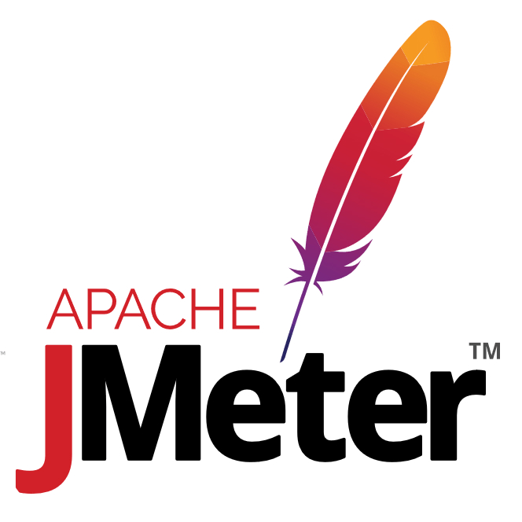
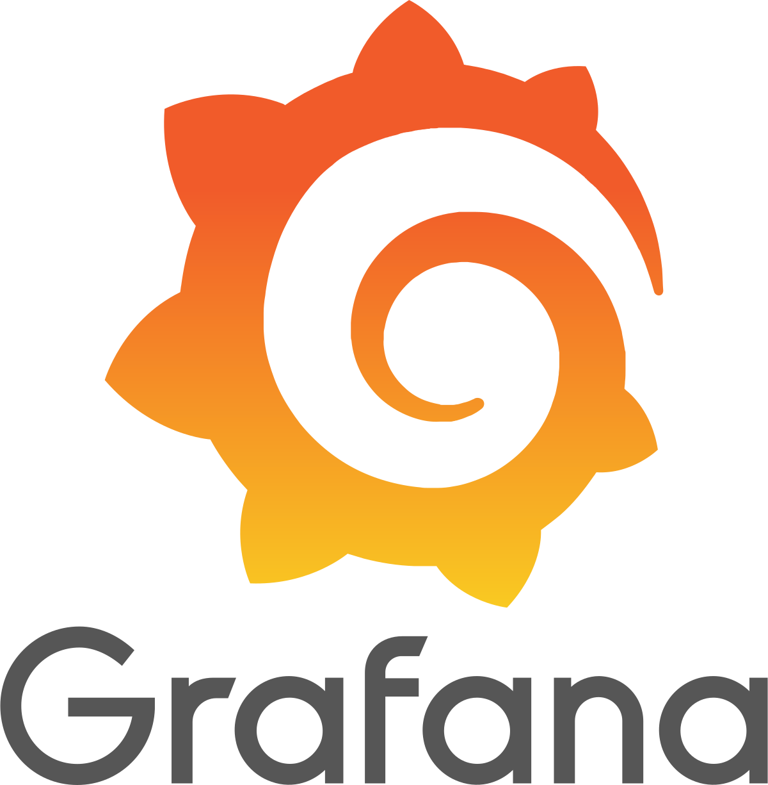

### Привет, меня зовут Никита 👋

 

### 🧐 Обо мне
В тестировании ПО более 5 лет.
Последние годы — в ФинТехе, в крупнейшем банке России.
Работаю с ручным тестированием и автоматизацией. 
Участник Bug Bounty. 
А ещё сам разработал мобильное приложение (вот оно → https://clck.ru/3TGrJz).
Легко нахожу общий язык с людьми, с легкостью вливаясь в новый коллектив. 
Активно развиваюсь в сторону автоматизации тестирования на Java.
Я нашел себя в улучшении качества продукта и искренне люблю это дело.

Мне нравится исследовать новый стек технологий 💻 и использовать их для создания крутых вещей 🛠️.

📝 Вы можете ознакомиться с моим [резюме](https://sergiev-posad.hh.ru/resume/36e9913fff0918ce7a0039ed1f6c55777a7049?hhtmFrom=profile) .

### 🔨 Навыки и инструменты:

<code></code>
<code></code>
<code></code>
<code></code>
<code></code>
<code></code>
<code></code>
<code></code>

[//]: # (<code></code>)

[//]: # (### 📈 моя статистика на гитхабе)

[//]: # (
 )

<!--
**NikitinNL/NikitinNL** is a ✨ _special_ ✨ repository because its `README.md` (this file) appears on your GitHub profile.

Here are some ideas to get you started:

- 🔭 I’m currently working on ...
- 🌱 I’m currently learning ...
- 👯 I’m looking to collaborate on ...
- 🤔 I’m looking for help with ...
- 💬 Ask me about ...
- 📫 How to reach me: ...
- 😄 Pronouns: ...
- ⚡ Fun fact: ...
-->
